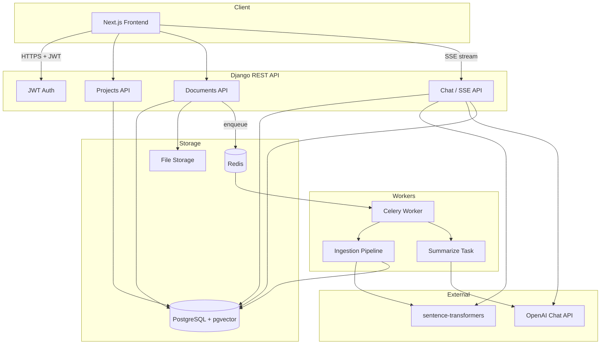
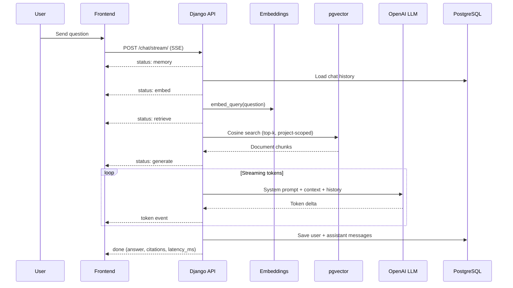
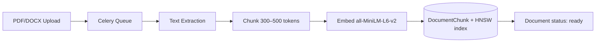

# System Architecture

This document describes the architecture of the ASE2026 Real-Time Academic Research Assistant.

## High-level overview

## RAG query pipeline (Q&A mode)

## Document ingestion pipeline

## Four pipeline modes

| Mode | Retrieval scope | Output |
|------|-----------------|--------|
| **Q&A** | Top-k vector chunks (Fast: 3, Deep: 10) | Cited factual answer |
| **Literature** | Top-k across project (Fast: 15, Deep: 25) | Thematic exploration report |
| **Synthesis** | Top-k across project (Fast: 20, Deep: 40) | Multi-paper literature review |
| **Summarize** | All chunks of one document | Map-reduce structured summary |

## Technology stack

| Layer | Technology |
|-------|------------|
| Frontend | Next.js 15, React, Tailwind CSS, shadcn/ui |
| API | Django 5, Django REST Framework, JWT |
| Async jobs | Celery, Redis |
| Database | PostgreSQL 16, pgvector (HNSW cosine index) |
| Embeddings | sentence-transformers (`all-MiniLM-L6-v2`, 384-dim, local CPU) |
| Generation | OpenAI Chat API (`gpt-4o-mini`) |
| Orchestration | LangGraph-style pipeline nodes, SSE streaming |
| Deployment | Docker Compose (db, redis, backend, worker, frontend) |

## Security and isolation

- **Authentication:** JWT access + refresh tokens
- **Authorization:** Projects are user-scoped; all chat and document routes require membership
- **Retrieval scope:** Vector search is filtered by `project_id` and `document.status = ready`
- **Grounding:** Prompts instruct the model to answer only from retrieved excerpts; Q&A returns "Not found in the provided documents" when context is insufficient

## Latency design choices

| Choice | Rationale |
|--------|-----------|
| Fast mode (k=3) | Lower time-to-first-token for interactive chat |
| Deep mode (k=10) | More context for complex questions |
| No reranking step | Removes cross-encoder latency and cost |
| HNSW index | Sub-linear approximate nearest-neighbor search |
| Embedding warm-up on startup | Reduces first-query cold start |
| SSE streaming | User sees progress (status + tokens) immediately |
| Refine with Deep | Two-phase pattern: fast draft → optional deep refine |
